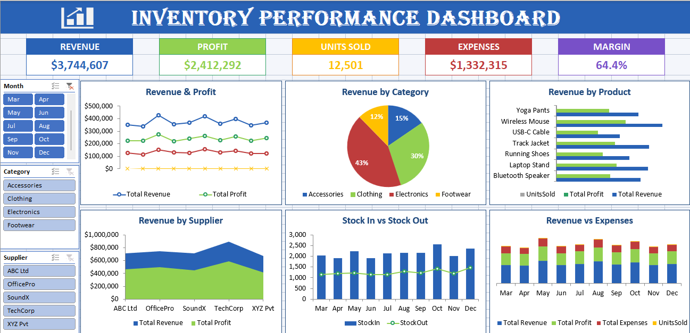
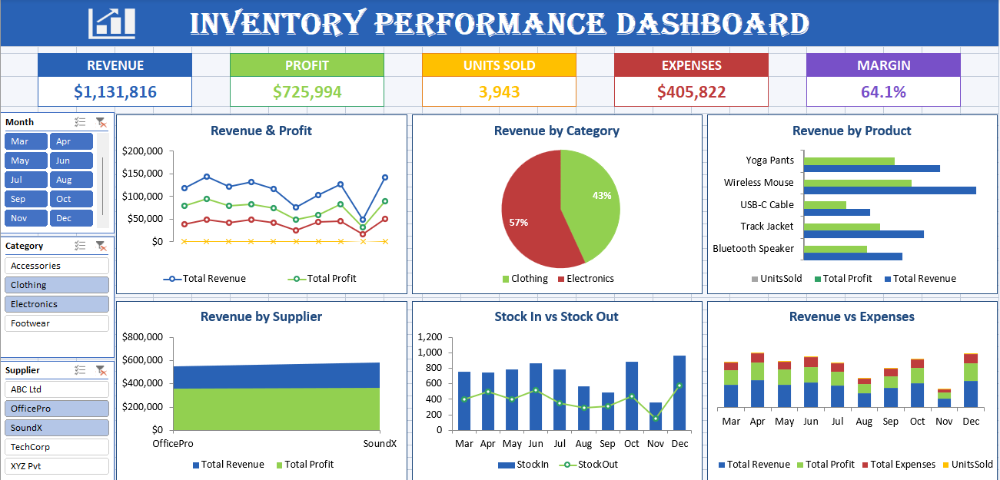
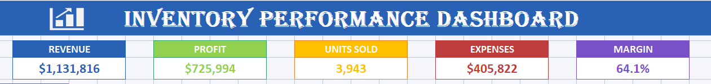
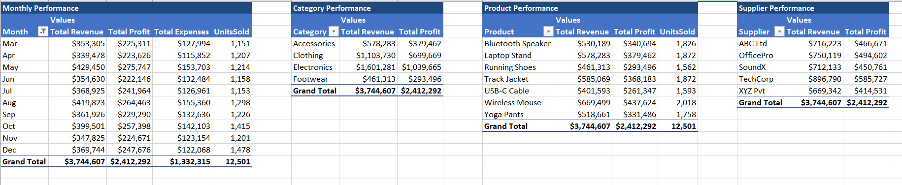

# 📦 Retail Inventory & Financial Performance Dashboard

> An interactive, data-driven Microsoft Excel dashboard designed to track full-year retail operations, optimize inventory flow, and deliver actionable financial insights.

---

## 📌 Project Overview

The **Retail Inventory & Financial Performance Dashboard** translates 365 days of retail transaction logs into actionable business insights. Built entirely in Microsoft Excel, this project bridges raw operational data and executive decision-making through interactive filtering, high-level KPI cards, and dynamic visual analytics.

---

## 🎯 Business Objective

Managing inventory requires a careful balance between stock availability and profitability. This project addresses critical retail operational questions:
* **Inventory Efficiency:** Tracking stock movement (Stock In vs. Stock Out) to prevent overstocking and stockouts.
* **Financial Performance:** Analyzing revenue, expenses, and net profit margins across distinct product lines.
* **Vendor & Product Strategy:** Identifying top-performing categories, high-velocity products, and key supplier contributions.

---

## 🛠️ Dashboard Architecture

The workbook is structured into three distinct layers to ensure clean separation between raw data, processing, and visual presentation:

| Worksheet Tab | Icon | Description & Function |
| :--- | :---: | :--- |
| **Dashboard** | 📊 | Executive overview featuring high-level KPI scorecards, dynamic charts, and interactive Slicers. |
| **Pivot** | 📈 | Analytical processing engine containing structured PivotTables (Monthly Trends, Category/Product breakdowns, Supplier metrics, Stock Flow). |
| **Data** | 📑 | Source dataset containing 365 daily transaction logs across all operational dimensions. |

---

## 💡 Key Performance Highlights

An analysis of the full-year dataset reveals key operational metrics:

* **Financial Summary:** Generated **$4,536,842** in total revenue against **$1,587,614** in expenses, producing a net profit of **$2,949,228**.
* **Profitability:** Maintained an overall average profit margin of **~65%**.
* **Volume Movement:** Tracked **15,040 units sold** across **7 core products**, **4 product categories** (Clothing, Electronics, Footwear, Accessories), and **5 primary suppliers**.

---

## 🖼️ Dashboard Preview & Visuals

### Interactive Filtering & Month-over-Month Analysis

*Use built-in Slicers to filter metrics by Month, Category, or Supplier in real time.*

### Detailed Sales & Category Breakdown

*In-depth performance evaluation across categories, product lines, and revenue streams.*

### Underlying Data Architecture & Pivot Tables

*Structured PivotTable processing powering the dashboard front-end.*

---

## 🚀 How to Explore the Workbook

1. **Download:** Download `Data.xlsx` directly from this repository.
2. **Open:** Open the file in Microsoft Excel (version 2016 or newer recommended).
3. **Interact:** Navigate to the **Dashboard** tab and use the interactive Slicers to filter views by category, supplier, or timeframe.

---

## 🧰 Tools Used

* **Microsoft Excel:** Data modeling, PivotTables, PivotCharts, Slicers, and custom KPI scorecards.

---

## 👩‍💻 Author

**Fatima Kassidi**  
*Data Analytics | Excel | SQL | Power BI | Python*

> **Note:** For full interactivity, download `Data.xlsx` and open it directly in Microsoft Excel.